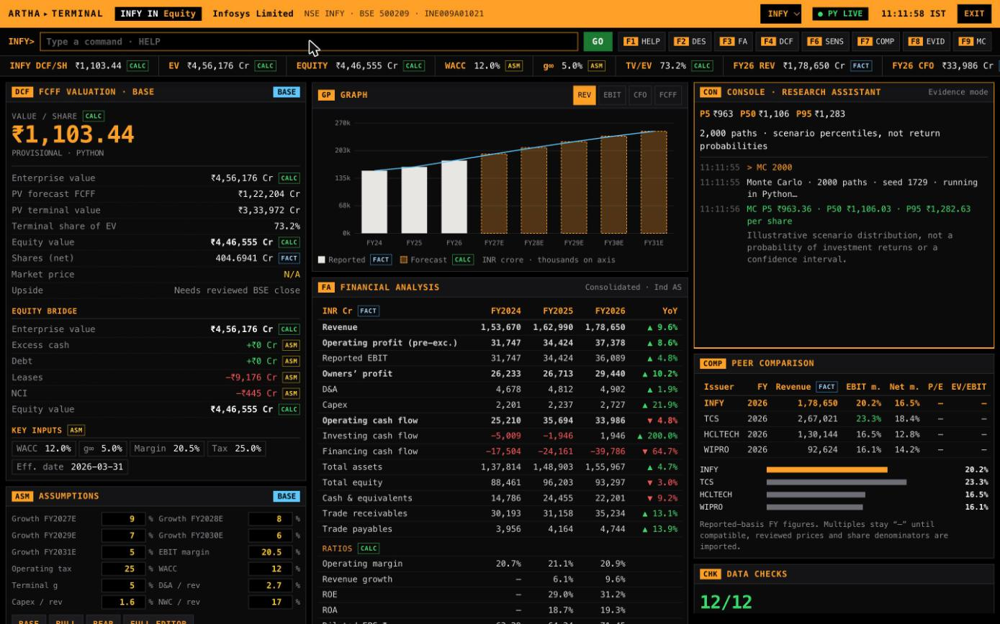
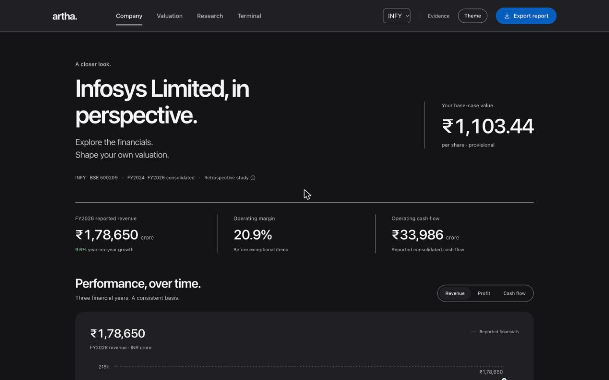

# Artha Equity

**AI-powered equity research and valuation for Indian listed companies, where every number shows where it came from.**

[](https://github.com/krishnashahane/artha-equity/actions/workflows/ci.yml)


**Live demo:** https://artha-equity.vercel.app · **Terminal:** https://artha-equity.vercel.app/#terminal



Artha answers three questions about a listed company:

1. **How is the business performing?** It shows reviewed financial statements, ratios and peers.
2. **What could the equity be worth under stated assumptions?** It runs a five-year FCFF/DCF with scenarios, sensitivity, Monte Carlo and reverse DCF.
3. **What supports the answer?** Every value links to a filing, a page and a publication date.

> Educational research software. It does not give investment advice or make price predictions.

---

## Contents

- [Two ways to work](#two-ways-to-work)
- [Every number has a label](#every-number-has-a-label)
- [Quick start](#quick-start)
- [Terminal commands](#terminal-commands)
- [How the valuation works](#how-the-valuation-works)
- [Architecture](#architecture)
- [Security](#security)
- [Deployment](#deployment)
- [API](#api)
- [Testing](#testing)
- [Coverage and limits](#coverage-and-limits)
- [Project layout](#project-layout)
- [Documentation](#documentation)

---

## Two ways to work

| | **Workspace** (default) | **Terminal** (`#terminal` or press `` ` ``) |
|---|---|---|
| Style | Calm, spacious, detail on demand | Dense, dark, keyboard-first |
| Navigation | Company · Valuation · Research | Command line, F-keys, 11 linked panels |
| Best for | Learning, presenting, reading | Fast what-if analysis and cross-checking |



Both read the same Python results and the same reviewed data. Light and dark appearances work, and the layout adapts down to 768 px wide.

## Every number has a label

Artha keeps four kinds of value apart in the UI, in exports and in AI answers:

| Label | Meaning | Example |
|---|---|---|
| `FACT` | Reported figure from a reviewed filing | FY2026 revenue **₹1,78,650 Cr** (Infosys consolidated statement, PDF p.3, published 23 Apr 2026) |
| `ASM` | Analyst assumption, editable | **9%** FY2027E revenue growth |
| `CALC` | Python calculation from facts and assumptions | ₹1,78,650 × 1.09 = **₹1,94,728.5 Cr** FY2027E revenue |
| `INTERP` | Explanation of the evidence | "Growth reflects…", always cited |

Unavailable stays unavailable. No reviewed same-date BSE close is on file, so the app shows market price, market cap and upside as **N/A**. It never fills them in from a provider quote or a hypothetical price.

## Quick start

You need **Node.js 20+** and **Python 3.10+**. The running app uses only the Node and Python standard libraries.

```bash
git clone https://github.com/krishnashahane/artha-equity.git
cd artha-equity
npm run build
npm start
```

Open http://127.0.0.1:3000 and press `` ` `` to switch to the terminal.

Run the valuation from the command line without a browser:

```bash
npm run model -- --company infosys --scenario base
```

## Terminal commands

Type a command and press **Enter**. Other keys:

- **↑/↓** recall earlier commands.
- **Tab** completes a command.
- **Esc** clears the line.
- **F1 HELP · F2 DES · F3 FA · F4 DCF · F6 SENS · F7 COMP · F8 EVID · F9 MC** jump to panels. F5 is left to the browser.

| Command | What it does |
|---|---|
| `HELP` | List all commands |
| `INFY` or `LOAD INFY` | Load a reviewed issuer by ticker, scrip code or ISIN |
| `LOAD TCS` | Explain what evidence a peer-only issuer needs before it gets its own DCF |
| `DES` `FA` `DCF` `SENS` `COMP` `CHK` `EVID` | Jump to a panel |
| `GP REV` · `GP EBIT` · `GP CFO` · `GP FCFF` | Switch the chart |
| `BASE` `BULL` `BEAR` | Load a scenario |
| `WACC 11.5` · `TG 4.5` · `TAX 25` · `MARGIN 21` | Change one assumption (in %) and recalculate in Python |
| `GROW 9 8 7 6 5` | Set five annual growth rates |
| `DA 2.7` · `CAPEX 1.6` · `NWC 17` | Set reinvestment ratios as % of revenue |
| `MC 2000` | Seeded Monte Carlo with 100–5000 paths, reporting P5/P50/P95 |
| `RDCF 1500` | Growth rate implied by a *hypothetical* price |
| `ASK how does WACC change the valuation?` | Cited, evidence-based explanation |
| `SRCH FY2026 revenue` | BM25 search over reviewed facts, with PDF page links |
| `ASM` · `EXP` · `CSV` | Full assumptions editor · research packet · forecast CSV |
| `CLR` · `EXIT` | Clear the console · return to the workspace |

The panels are: valuation and equity bridge, history and forecast chart, assumptions (press Enter to recalculate), financial analysis, FCFF schedule, WACC × terminal-growth sensitivity, company identifiers, evidence and lineage, console, peers, and reconciliation checks. See [docs/TERMINAL.md](docs/TERMINAL.md).

## How the valuation works

1. **Establish the history.** Use three consolidated Ind AS years in INR crore. Twelve checks run: four accounting identities per year, within ±₹1 crore.
2. **Forecast free cash flow to the firm.** `FCFF = EBIT × (1 − tax) + D&A − capex − ΔNWC`, where working capital is trade receivables minus trade payables.
3. **Discount.** Discount periods are elapsed days ÷ 365.25. Terminal value is `TV = FCFF_next / (WACC − g)`, which requires `WACC > g`.
4. **Bridge to equity.** Start from enterprise value, add assessed excess cash, then subtract debt, leases and non-controlling interests. Divide by dated net shares (404.6940812 crore at 31 March 2026, treasury shares already excluded).
5. **Stress it.** Run the WACC × g sensitivity grid, the seeded Monte Carlo (seed 1729) and the reverse DCF.

**Default Infosys case.** The defaults below are educational, not forecasts. The case is retrospective: it uses later-published filings as of 31 March 2026.
- Growth: 9 / 8 / 7 / 6 / 5 %
- EBIT margin: 20.5%
- Operating tax: 25%
- WACC: 12%
- Terminal growth: 5%

Methodology and review notes are in [docs/MODEL_REVIEW.md](docs/MODEL_REVIEW.md).

## Architecture

```
Browser (public/*.js)                Node (backend/server.mjs)             Python (backend/python_service.py)
─────────────────────               ─────────────────────────             ──────────────────────────────────
Workspace + Terminal  ── JSON ──▶   auth · rate limits · origin   ──stdin──▶  portable_finance  (FCFF/DCF)
renders results only                checks · CSP · static files    ◀─stdout─  fundamental_analytics
BM25 evidence search                bounded worker pool (2×16)               valuation_studies (MC, reverse DCF)
                                    optional LLM, validated                  research_store    (SQLite, optional)
```

- **Python is the only source of financial calculations.** Browser modules render values and never compute a valuation.
- **Workers are isolated per request.** Each Python call runs as a separate process with a 30 s timeout, a 2 MB output cap, no shell, and a minimal environment that excludes passwords and API keys.
- **Responses are checked for staleness.** The UI discards a result if the company or the inputs changed while it was in flight.

## Security

| Area | Control |
|---|---|
| Authentication | Optional HTTP Basic auth with constant-time comparison. Failed sign-ins are throttled to 10 per minute per client. Production refuses to start without a password unless `APP_PUBLIC_ACCESS=true` is set explicitly. |
| Cross-site requests | POST requires a JSON body under 32 KB and a same-origin `Origin`. `Sec-Fetch-Site: cross-site` is rejected. |
| Proxies | With `TRUST_PROXY=1`, forwarded client IP, protocol and host are used for rate limits, origin checks and HSTS. |
| Rate limiting | 90 API requests per minute per client, with memory-bounded buckets. |
| Headers | Strict CSP (`script-src 'self'`, `object-src 'none'`, `frame-ancestors 'none'`), `X-Frame-Options: DENY`, `nosniff`, COOP/CORP, Permissions-Policy, HSTS over HTTPS. |
| Input | API fields are whitelisted. Python validates every assumption's range, date and unit. Errors are generic, with no tracebacks or paths. |
| Output | All interpolated HTML is escaped. Only `https:` links render. |
| Secrets | Optional LLM keys stay on the server and never reach the browser or the Python workers. `.env` files are git- and docker-ignored. |
| LLM answers | Each answer must cite existing source IDs, and every number in it must already appear in the packet. Otherwise the app falls back to evidence mode. |
| Containers | tini, non-root user, root-owned read-only code. Compose adds a read-only root filesystem, `cap_drop: ALL`, `no-new-privileges` and a loopback port bind. |
| Dependencies | Zero runtime packages. CI runs `pip-audit` on the dev requirements. |

To report a vulnerability, open a private GitHub security advisory on this repository.

## Deployment

### Vercel (live demo)

`Dockerfile.vercel` runs the full Node + Python app on Vercel's container runtime as an anonymous demo. It sets `APP_PUBLIC_ACCESS=true`, `ARTHA_STORAGE_MODE=browser` and `TRUST_PROXY=1`. Saved scenarios and notes stay in the browser.

```bash
vercel link
vercel env add PORT production     # value: 3000
vercel deploy --prod
```

To require sign-in, set `APP_AUTH_PASSWORD` in the Vercel project settings.

### Docker Compose (persistent history)

```bash
cp .env.example .env        # set APP_AUTH_PASSWORD
docker compose up --build -d
```

This keeps SQLite run history in the `artha-research` volume and binds to `127.0.0.1:3000`. Set `APP_BIND=0.0.0.0` only behind your own TLS proxy. See [docs/DEPLOYMENT.md](docs/DEPLOYMENT.md) and [docs/OPERATIONS.md](docs/OPERATIONS.md).

### Environment variables

| Variable | Default | Purpose |
|---|---|---|
| `APP_AUTH_USER` / `APP_AUTH_PASSWORD` | `research` / none | Basic auth; the password is required in production unless public access is enabled |
| `APP_PUBLIC_ACCESS` | off | `true` allows an anonymous production demo |
| `HOST` / `PORT` | `127.0.0.1` / `3000` | Bind address |
| `TRUST_PROXY` | off | Trust `X-Forwarded-*` headers from your proxy or CDN |
| `APP_PUBLIC_ORIGIN` | none | Exact public origin when TLS ends at a proxy |
| `ARTHA_STORAGE_MODE` | `server` | `browser` disables server-side SQLite history |
| `PYTHON_WORKERS` / `PYTHON_QUEUE_LIMIT` | `2` / `16` | Calculation concurrency |
| `RESEARCH_RETENTION_DAYS` | `365` | Saved-run retention (`0` keeps runs forever) |
| `LLM_API_KEY` / `LLM_MODEL` / `LLM_API_URL` | none | Optional explanation provider (HTTPS only) |

## API

All POST bodies are JSON objects. Rates are decimals, money is in INR crore, and per-share values are in INR.

| Method | Endpoint | Input → result |
|---|---|---|
| GET | `/api/health` | Public liveness, version, storage mode |
| GET | `/api/ready` | Python, reconciliation and storage readiness (503 if not ready) |
| GET | `/api/companies` | Registered issuers |
| POST | `/api/valuation` | `{companyId, assumptions?, persist?, marketOverrides?}` → FCFF, sensitivity, bridge, checks, peers |
| POST | `/api/analytics` | `{companyId, assumptions?}` → fundamental ratios |
| POST | `/api/capital-cost` | `{inputs}` → CAPM/WACC |
| POST | `/api/monte-carlo` | `{companyId, assumptions?, options?}` → seeded P5/P50/P95 and histogram |
| POST | `/api/reverse-dcf` | `{companyId, assumptions?, price}` → implied flat growth |
| GET | `/api/runs?companyId=` | Saved-run metadata (empty in browser storage mode) |
| POST | `/api/packet` | `{companyId, assumptions?}` → research packet |
| POST | `/api/retrieval` | `{companyId, question}` → ranked source facts |
| POST | `/api/assistant` | `{companyId, question, assumptions?}` → cited explanation |

Status codes:
- `400` malformed request
- `401` / `403` authentication or origin failure
- `415` wrong content type
- `422` invalid model inputs
- `429` rate limit
- `503` calculation service busy or not ready

## Testing

```bash
python3 -m venv .venv && source .venv/bin/activate
pip install -r requirements.txt      # pandas etc. for parity and notebook tests only
npm run check                        # build + 71 Node tests + 56 Python tests
npm run preflight                    # 12/12 reconciliations per registered issuer
```

The suites cover:
- the FCFF model, and parity against an independent pandas engine,
- reconciliations, cutoff dates and share-count rules,
- API validation and authentication,
- proxy-aware origin checks and rate limits,
- security headers and browser storage mode,
- that worker environments exclude secrets,
- the terminal's rendering, command validation and HTML escaping.

CI runs them on Node 20/22 × Python 3.10/3.12, plus `pip-audit` and Docker builds.

## Coverage and limits

- **Fully reviewed issuer: Infosys** (NSE `INFY`, BSE `500209`, ISIN `INE009A01021`), FY2024–FY2026, with 93 page-linked facts.
- **Peers:** TCS, HCLTech and Wipro have FY2026 reported figures for comparison only. Activating an issuer's own DCF needs a reviewed package; see [docs/COMPANY_ONBOARDING.md](docs/COMPANY_ONBOARDING.md).
- **Financial firms:** the FCFF model refuses banks and insurers, which need their own methodology.
- **AI:** the assistant runs BM25 retrieval over curated facts, plus an optional validated LLM. These are future work, not implemented: whole-filing semantic RAG, news ingestion, FinBERT sentiment and live market feeds.
- **Market data:** no market price is shown until a reviewed same-date BSE close and a matching dated share count are imported.

## Project layout

| Path | Responsibility |
|---|---|
| `backend/server.mjs` | HTTP routes, auth, limits, security headers, optional LLM |
| `backend/python_bridge.mjs` | Bounded, isolated Python worker pool |
| `backend/python_service.py` | Python request dispatch and validation |
| `src/portable_finance.py` | Dependency-free production FCFF/DCF model |
| `src/fundamental_analytics.py` | Ratios, CAPM/WACC, multiples, peer-implied values |
| `src/valuation_studies.py` | Monte Carlo and reverse DCF |
| `src/company_workspace.py` | Reviewed-issuer packages and validation |
| `src/research_store.py` | SQLite snapshots, retention, backups |
| `src/equity_platform.py` | pandas reference engine for notebooks and parity tests |
| `public/terminal.js` | Artha Terminal |
| `public/app.js` · `state.js` · `views.js` · `dialogs.js` · `charts.js` · `api.js` | Workspace UI modules |
| `public/retrieval.js` | BM25 evidence retrieval |
| `data/source_snapshot.json` · `data/companies.json` | Reviewed facts and the app dataset |
| `scripts/` | Build, data preparation, onboarding, imports, CLI, preflight |
| `tests/` · `web-tests/` | Python and Node test suites |
| `Dockerfile` · `Dockerfile.vercel` · `compose.yaml` | Deployment |

## Documentation

- [Learning guide](docs/LEARNING_GUIDE.md): the finance concepts, before the code
- [Terminal](docs/TERMINAL.md) · [UI modules](docs/UI_MODULES.md) · [Design system](docs/DESIGN_SYSTEM.md)
- [Architecture](docs/ARCHITECTURE.md) · [Model review](docs/MODEL_REVIEW.md) · [Valuation studies](docs/VALUATION_STUDIES.md)
- [Company onboarding](docs/COMPANY_ONBOARDING.md) · [RAG guide](docs/RAG_GUIDE.md) · [Requirements audit](docs/REQUIREMENTS_AUDIT.md)
- [Deployment](docs/DEPLOYMENT.md) · [Operations](docs/OPERATIONS.md) · [Changelog](CHANGELOG.md)

## Credits

This started as a B.Sc. Data Science Project-Based Learning project at Symbiosis Skills & Professional University, Pune. Original repository: [adityamakurwar97-cyber/Ai-powered-Equity-reserch-and-Valuation-platform-](https://github.com/adityamakurwar97-cyber/Ai-powered-Equity-reserch-and-Valuation-platform-).

Released under the [MIT License](LICENSE). Financial figures come from the issuers' public filings, linked in the app.
